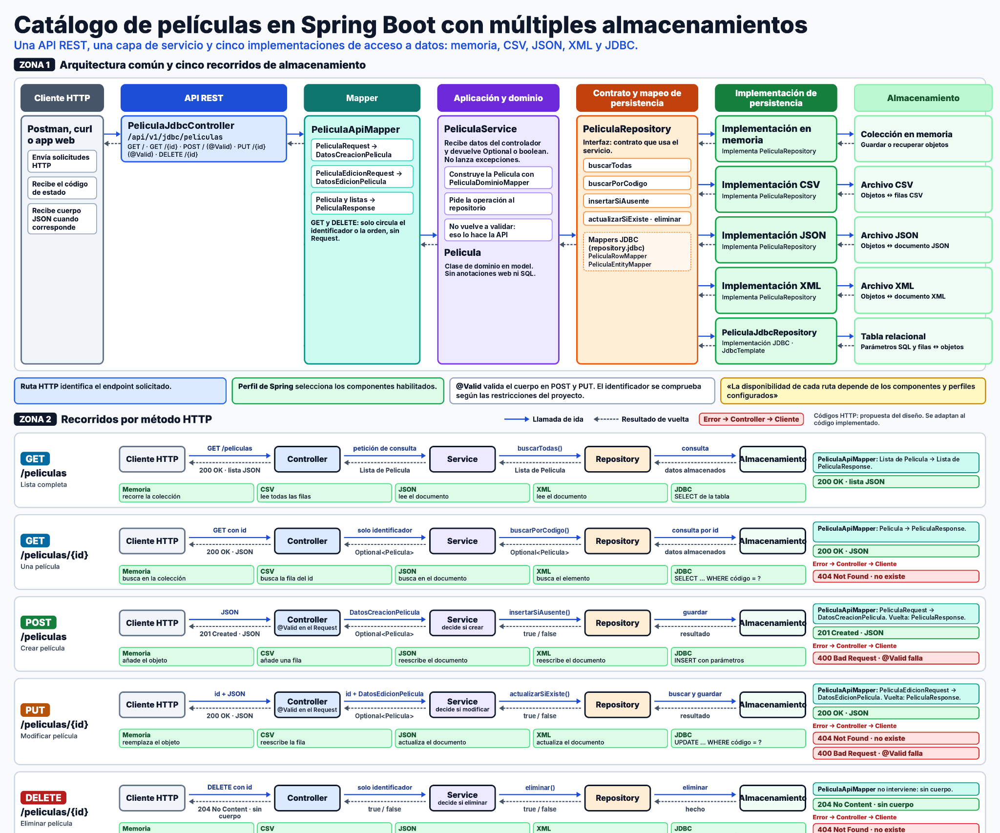

# Práctica guiada · API REST de películas con SQLite3 y JDBC

Construye el CRUD del catálogo de películas con **Java 21, Spring Boot, Maven y SQLite3**. Sigue el recorrido JDBC de la infografía. La API trabaja con JSON, el servicio con objetos de dominio y el repositorio con filas SQL. El objetivo es que identifiques qué datos pasan de una capa a otra y dónde se transforman.



En la **zona 1**, localiza el controlador JDBC, el servicio, el contrato del repositorio y la tabla. En la **zona 2**, sigue las cinco peticiones HTTP. En esta práctica se usa el perfil `jdbc` con un fichero SQLite. Los ejemplos JSON de esta guía definen el contrato del ejercicio.

## 1. Abre la base de datos de trabajo

El paquete incluye `data/peliculas.sqlite3`, con la tabla `peliculas` y dos registros de ejemplo (`PEL001` y `PEL002`). Copia la carpeta `data` al directorio del proyecto Java donde está `pom.xml`. Arranca siempre desde ese directorio, porque la URL de SQLite usa una ruta relativa.

Si tienes el cliente de terminal `sqlite3`, comprueba el esquema y los datos:

```bash
sqlite3 -readonly data/peliculas.sqlite3 ".tables"
sqlite3 -readonly data/peliculas.sqlite3 ".schema peliculas"
sqlite3 -readonly -header -column data/peliculas.sqlite3 < data/consultas.sql
```

Para crear una base vacía con el mismo esquema, desde el paquete de la guía:

```bash
sqlite3 data/peliculas-vacia.sqlite3 < schema-sqlite.sql
```

## 2. Configura el proyecto y la conexión JDBC

En el `pom.xml`, usa `<groupId>ies.puesto</groupId>`, `<artifactId>peliculas</artifactId>` y `<java.version>21</java.version>`. Comprueba `mvn -version`. Incluye Spring Web, Validation, JDBC y springdoc.

Añade el driver de SQLite y configura la conexión con la base de datos `data/peliculas.sqlite3`.

Ten en cuenta:

- El controlador y el repositorio JDBC solo se activan con el perfil `jdbc`, que eliges al arrancar (apartado 9).
- La tabla ya existe en `data/peliculas.sqlite3`, así que la aplicación no crea el esquema. Los datos se guardan en el fichero y se conservan al reiniciar.
- Si el fichero no existe en `data/`, SQLite crea uno vacío **sin la tabla** y todas las consultas fallarán. Para empezar con una base nueva, créala con el comando del apartado 1 y renómbrala a `peliculas.sqlite3`.
- **No hay manejador global de excepciones en esta práctica.** Los errores de entrada (400) los responde Spring con su formato de error por defecto. Los 404 y 409 los devuelve tu controlador con `ProblemDetail`.

## 3. Organiza los paquetes

Todas las clases cuelgan de `ies.puesto.peliculas`. La clase con `@SpringBootApplication` debe estar **en ese paquete raíz**: Spring solo detecta los componentes de su paquete y de los que están por debajo. Si partes de un proyecto con otro paquete (por ejemplo, `com.example.peliculas`), mueve **todas** las clases; si queda alguna en el paquete antiguo, Spring no la encontrará.

```
ies.puesto.peliculas
├── PeliculasApplication
├── controller
│   ├── PeliculaJdbcController
│   ├── api
│   │   ├── PeliculaRequest
│   │   ├── PeliculaEdicionRequest
│   │   └── PeliculaResponse
│   └── mapper
│       └── PeliculaApiMapper
├── service
│   ├── PeliculaService
│   ├── modelo
│   │   ├── DatosCreacionPelicula
│   │   └── DatosEdicionPelicula
│   └── mapper
│       └── PeliculaDominioMapper
├── model
│   └── Pelicula
└── repository
    ├── PeliculaRepository
    └── jdbc
        ├── PeliculaJdbcRepository
        ├── PeliculaEntity
        ├── PeliculaRowMapper
        └── PeliculaEntityMapper
```

### Reglas de dependencia

| Paquete | Puede usar | No puede usar |
|---|---|---|
| `controller` | `service`, `model` | `repository` |
| `service` | `model`, `repository` | `controller`, `repository.jdbc` |
| `model` | — | ningún otro paquete del proyecto |
| `repository.jdbc` | `repository`, `model` | `controller`, `service` |

Declara `PeliculaEntity`, `PeliculaRowMapper` y `PeliculaEntityMapper` **sin `public`** (visibilidad de paquete). Así, si alguien intenta usar una fila SQL fuera de `repository.jdbc`, el código no compila. Spring los detecta e inyecta igualmente.

## 4. Define los tipos y nombra cada frontera

**Los nombres cambian deliberadamente entre representaciones**: ningún objeto puede pasar de una capa a otra sin un mapper. Escribe tú cada tipo a partir de estas especificaciones.

| Dato | `controller.api` | `service.modelo` | `model` | `repository.jdbc` | Columna SQLite |
|---|---|---|---|---|---|
| Identificador | `codigo` | `referenciaSolicitada` | `identificador` | `codigoFila` | `pelicula_codigo` |
| Título | `titulo` | `nombreSolicitado` | `nombre` | `tituloFila` | `titulo_texto` |
| Año | `anioEstreno` | `anioSolicitado` | `anioLanzamiento` | `anioFila` | `estreno_anio` |
| Duración | `duracionMinutos` | `minutosSolicitados` | `minutosProyeccion` | `minutosFila` | `duracion_minutos` |

| Paquete | Tipo de Java | Por qué |
|---|---|---|
| `controller.api` | `record` | Son mensajes JSON inmutables: solo transportan datos |
| `service.modelo` | `record` | Son datos de entrada al servicio: solo transportan datos |
| `model` | `class` | Representa una película del catálogo |
| `repository.jdbc` | `class` | Representa una fila de la tabla |

### Capa web · `controller.api`

Crea tres `record`. Pon las anotaciones de Bean Validation en los componentes de las peticiones.

| Record | Uso | Componentes |
|---|---|---|
| `PeliculaRequest` | Cuerpo del POST | `codigo`, `titulo`, `anioEstreno`, `duracionMinutos` |
| `PeliculaEdicionRequest` | Cuerpo del PUT | `titulo`, `anioEstreno`, `duracionMinutos` (sin código: llega en la URL `/{codigo}`) |
| `PeliculaResponse` | Respuesta de GET, POST y PUT | `codigo`, `titulo`, `anioEstreno`, `duracionMinutos` |

Reglas de validación de las peticiones:

| Campo | Tipo en la petición | Regla |
|---|---|---|
| `codigo` | `String` | Obligatorio. Sigue el patrón `^PEL[0-9]{3}$` |
| `titulo` | `String` | Obligatorio, hasta 120 caracteres y con algún carácter distinto de espacio |
| `anioEstreno` | `Integer` | Obligatorio, entre 1888 y 2100 |
| `duracionMinutos` | `Integer` | Obligatorio, entre 1 y 1000 |

En las peticiones, el año y la duración son `Integer` y no `int`. Así, un campo ausente produce un error de «obligatorio» en lugar de convertirse en `0`. En `PeliculaResponse` y en el resto de capas, usa `int`.

### Capa de servicio · `service.modelo`

| Record | Componentes |
|---|---|
| `DatosCreacionPelicula` | `referenciaSolicitada` (`String`), `nombreSolicitado` (`String`), `anioSolicitado` (`int`), `minutosSolicitados` (`int`) |
| `DatosEdicionPelicula` | `nombreSolicitado` (`String`), `anioSolicitado` (`int`), `minutosSolicitados` (`int`) |

Representan **lo que se ha pedido** al servicio, ya validado por la capa web. No llevan anotaciones de validación.

### Dominio · `model`

`Pelicula` es una **clase** con:

- Cuatro atributos `private final`: `identificador` (`String`), `nombre` (`String`), `anioLanzamiento` (`int`) y `minutosProyeccion` (`int`).
- Un constructor que recibe los cuatro valores en ese orden.
- Un getter por atributo (`getIdentificador()`, `getNombre()`, `getAnioLanzamiento()`, `getMinutosProyeccion()`). No lleva setters: una película se sustituye entera al actualizarla.

No lleva anotaciones web ni de persistencia.

### Persistencia · `repository.jdbc`

`PeliculaEntity` es una **clase** con visibilidad de paquete que representa una fila de la tabla:

- Cuatro atributos `private final`: `codigoFila` (`String`), `tituloFila` (`String`), `anioFila` (`int`) y `minutosFila` (`int`).
- Un constructor con los cuatro valores en ese orden y un getter por atributo (`getCodigoFila()`, `getTituloFila()`, `getAnioFila()`, `getMinutosFila()`).

Es una clase normal, **sin `@Entity`**: en esta práctica no se usa JPA. Se rellena de forma explícita desde el `ResultSet`.

## 5. Implementa los mappers

Los mappers hacen explícita la equivalencia entre nombres. Por ejemplo, `titulo` viaja como `nombreSolicitado` al servicio, `nombre` en el dominio, `tituloFila` en la entidad y `titulo_texto` en la tabla. Gracias a este reparto, puedes cambiar un nombre del JSON o del esquema SQL tocando solo su frontera.

Haz las conversiones con constructores. **No uses** `BeanUtils.copyProperties`, ModelMapper ni otros mapeos automáticos: como los nombres no coinciden, no copiarían ningún valor.

| Componente | Paquete | Métodos |
|---|---|---|
| `PeliculaApiMapper` | `controller.mapper` | `DatosCreacionPelicula aDatosCreacion(PeliculaRequest)` · `DatosEdicionPelicula aDatosEdicion(PeliculaEdicionRequest)` · `PeliculaResponse aRespuesta(Pelicula)` · `List<PeliculaResponse> aRespuestas(List<Pelicula>)` |
| `PeliculaDominioMapper` | `service.mapper` | `Pelicula aPelicula(DatosCreacionPelicula)` · `Pelicula aPelicula(String identificador, DatosEdicionPelicula)` |
| `PeliculaEntityMapper` | `repository.jdbc` | `PeliculaEntity aEntity(Pelicula)` · `Pelicula aPelicula(PeliculaEntity)` |
| `PeliculaRowMapper` | `repository.jdbc` | Implementa `RowMapper<PeliculaEntity>`: `ResultSet` → `PeliculaEntity`, leyendo las columnas por nombre |

Anota los cuatro con `@Component` e inyéctalos por constructor donde se usen.

Ejemplo del tramo de lectura:

```java
// PeliculaRowMapper
return new PeliculaEntity(
    rs.getString("pelicula_codigo"),
    rs.getString("titulo_texto"),
    rs.getInt("estreno_anio"),
    rs.getInt("duracion_minutos")
);

// PeliculaEntityMapper
return new Pelicula(
    fila.getCodigoFila(), fila.getTituloFila(),
    fila.getAnioFila(), fila.getMinutosFila()
);

// PeliculaApiMapper
return new PeliculaResponse(
    pelicula.getIdentificador(), pelicula.getNombre(),
    pelicula.getAnioLanzamiento(), pelicula.getMinutosProyeccion()
);
```

Fíjate en que los `record` se leen con accesores (`peticion.titulo()`) y las clases con getters (`pelicula.getNombre()`).

Los mappers solo transfieren valores. La validación de la petición corresponde a la API, las decisiones al servicio y el SQL al repositorio. En DELETE no interviene ningún mapper: solo viaja el código.

## 6. Implementa el contrato y el repositorio JDBC

### Contrato · `repository.PeliculaRepository`

```java
List<Pelicula> buscarTodas();
Optional<Pelicula> buscarPorCodigo(String identificador);
boolean insertarSiAusente(Pelicula pelicula);
boolean actualizarSiExiste(Pelicula pelicula);
boolean eliminar(String identificador);
```

El contrato trabaja solo con `Pelicula`. El servicio depende de esta interfaz, nunca de la implementación.

### Implementación · `repository.jdbc.PeliculaJdbcRepository`

Anótala con `@Repository`. Utiliza `PeliculaRowMapper` y `PeliculaEntityMapper`.

```sql
-- Listado
SELECT pelicula_codigo, titulo_texto, estreno_anio, duracion_minutos
FROM peliculas ORDER BY pelicula_codigo;

-- Consulta por código
SELECT pelicula_codigo, titulo_texto, estreno_anio, duracion_minutos
FROM peliculas WHERE pelicula_codigo = ?;

-- Creación
INSERT INTO peliculas (pelicula_codigo, titulo_texto, estreno_anio, duracion_minutos)
VALUES (?, ?, ?, ?) ON CONFLICT(pelicula_codigo) DO NOTHING;

-- Actualización
UPDATE peliculas SET titulo_texto = ?, estreno_anio = ?, duracion_minutos = ?
WHERE pelicula_codigo = ?;

-- Borrado
DELETE FROM peliculas WHERE pelicula_codigo = ?;
```

- **Lecturas:** usa `query(...)` y convierte cada `PeliculaEntity` en `Pelicula` antes de devolverla.
- **Consulta por código:** usa `query(...).stream().findFirst()`. **No uses `queryForObject`**, que lanza una excepción cuando no hay fila.
- **Escrituras:** convierte `Pelicula` → `PeliculaEntity` y usa `update(...)`. Devuelve `true` solo si el resultado es exactamente `1`. Cero filas en el INSERT significa que el código ya existe; cero filas en el UPDATE o el DELETE significa que no existe.
- **Orden de los parámetros `?`**, que es distinto en cada sentencia:

| Sentencia | Orden |
|---|---|
| INSERT | `codigoFila, tituloFila, anioFila, minutosFila` |
| UPDATE | `tituloFila, anioFila, minutosFila, codigoFila` (el código va el último, en el `WHERE`) |
| DELETE | `codigoFila` |


## 7. Implementa el servicio

`service.PeliculaService` (`@Service`) recibe por constructor `PeliculaRepository` y `PeliculaDominioMapper`. **No lanza excepciones**: indica el resultado con `Optional` o `boolean`.

```java
List<Pelicula> listar();
Optional<Pelicula> obtener(String codigo);
Optional<Pelicula> crear(DatosCreacionPelicula datos);
Optional<Pelicula> actualizar(String codigo, DatosEdicionPelicula datos);
boolean eliminar(String codigo);
```

| Método | Llama a | Resultado | Significado |
|---|---|---|---|
| `obtener` | `buscarPorCodigo` | con valor / vacío | encontrada / no existe |
| `crear` | `insertarSiAusente` | con valor / vacío | creada / **el código ya existía** |
| `actualizar` | `actualizarSiExiste` | con valor / vacío | actualizada / no existe |
| `eliminar` | `eliminar` | `true` / `false` | eliminada / no existe |

En `crear` y `actualizar`, el servicio construye la `Pelicula` con `PeliculaDominioMapper`, pide la operación al repositorio y devuelve esa misma `Pelicula` si tuvo éxito, sin volver a leerla. En la actualización, el identificador lo pone el código de la URL.

El servicio **no vuelve a validar** formatos ni rangos (eso lo hace la API) y no conoce ningún tipo web: ni `ResponseEntity`, ni `HttpStatus`, ni las clases de `controller.api`.

## 8. Implementa el controlador

`controller.PeliculaJdbcController` lleva `@RestController`, `@Profile("jdbc")` y `@RequestMapping("/api/v1/jdbc/peliculas")`. Inyecta `PeliculaService` y `PeliculaApiMapper`.

```java
@GetMapping
public List<PeliculaResponse> listar()

@GetMapping("/{codigo}")
public ResponseEntity<?> obtener(@PathVariable @Pattern(regexp = "^PEL[0-9]{3}$") String codigo)

@PostMapping
public ResponseEntity<?> crear(@Valid @RequestBody PeliculaRequest peticion)

@PutMapping("/{codigo}")
public ResponseEntity<?> actualizar(@PathVariable @Pattern(regexp = "^PEL[0-9]{3}$") String codigo,
                                    @Valid @RequestBody PeliculaEdicionRequest peticion)

@DeleteMapping("/{codigo}")
public ResponseEntity<?> eliminar(@PathVariable @Pattern(regexp = "^PEL[0-9]{3}$") String codigo)
```

- Valida el cuerpo con `@Valid @RequestBody`.
- Utiliza `@PathVariable` cuando sea necesario.
- **No pongas `@Validated` en la clase.** Con `@Validated`, un código inválido produce una excepción que, sin manejador global, termina en un **500** en lugar de un 400.
- El título es obligatorio, admite hasta 120 caracteres y debe contener algún carácter distinto de espacio (`@NotBlank`). El año va de 1888 a 2100 y la duración de 1 a 1000.


| Petición relativa a la ruta base | Entrada | Éxito | Error |
|---|---|---|---|
| GET | Sin cuerpo | `200` y lista JSON | |
| GET `/{codigo}` | Código | `200` y película | `400` código inválido, `404` no existe |
| POST | `PeliculaRequest` | `201` y película creada | `400` cuerpo inválido, `409` duplicado |
| PUT `/{codigo}` | Código en la URL y `PeliculaEdicionRequest` | `200` y película actualizada | `400` código o cuerpo inválido, `404` no existe |
| DELETE `/{codigo}` | Código | `204` sin cuerpo | `400` código inválido, `404` no existe |

**Origen de cada error:**

| Estado | Lo genera |
|---|---|
| `400` | Spring, al validar o leer la petición (con su formato de error por defecto) |
| `404`, `409` | `PeliculaJdbcController`, a partir del `Optional` vacío o del `false` del servicio |
| `500` | Errores inesperados, por ejemplo un fallo de SQLite |

## 9. Verifica el CRUD y la persistencia

### Pruebas automáticas

```bash
mvn clean test
```

> Construye tus pruebas de código


### Pruebas manuales

```bash
mvn clean spring-boot:run -Dspring-boot.run
```

En [Swagger UI](http://localhost:8080/swagger-ui.html), documenta las cinco operaciones, sus cuerpos y los estados de respuesta.

## 10. Entrega

El código dentro de un repositorio, además del zip. Añade dentro de la entrega `docs/SERVICIO.md`, y explica el recorrido de un **POST** y de un **GET por código**. Para cada uno, indica en orden:

1. Las clases por las que pasa la petición y la respuesta.
2. Qué mapper interviene en cada frontera.
3. Cómo se llama cada dato en cada capa, desde la propiedad JSON hasta la columna SQLite.
4. Cómo se decide el código HTTP final (`200`, `201`, `404` o `409`).

## Rúbrica (¿Cómo se evalúa?)

La práctica se califica sobre 10 puntos, repartidos en 8 bloques. Cada criterio se valora en uno de cuatro niveles; la nota del bloque es la media de sus criterios multiplicada por su peso.

| Nivel | Porcentaje del criterio | Significado |
| --- | --- | --- |
| Excelente | 100 % | Cumple todo lo que pide el README y funciona en todos los casos |
| Adecuado | 75 % | Cumple lo esencial; fallos menores que no rompen el contrato |
| En desarrollo | 40 % | Implementado a medias o con errores que afectan a algún caso |
| Insuficiente | 0 % | No está, no compila o contradice el README |

**Condiciones mínimas.** Si el proyecto no compila con `mvn clean test` o no arranca con `mvn clean spring-boot:run`, la nota máxima es 4. Si el código no se ha escrito por el alumno o la alumna (no sabe explicarlo en la posible defensa), el bloque afectado se califica como Insuficiente.

## Bloque 1 · Estructura y configuración (1 punto)

| Criterio | Excelente | Adecuado | En desarrollo | Insuficiente |
| --- | --- | --- | --- | --- |
| Paquetes | Todas las clases en `ies.puesto.peliculas` y sus subpaquetes, exactamente como en el árbol del README | Estructura correcta con algún nombre de paquete distinto | Capas mezcladas en un mismo paquete | Sin organización por capas |
| Reglas de dependencia | Ningún paquete importa lo que tiene prohibido; `PeliculaEntity` y los mappers JDBC sin `public` | Dependencias correctas, pero clases de `repository.jdbc` públicas | Alguna dependencia prohibida (p. ej. el servicio usa `repository.jdbc`) | El controlador accede al repositorio o a SQL |
| Maven y conexión | `pom.xml` con `ies.puesto`, Java 21, Web, Validation, JDBC, springdoc y driver de SQLite; conecta con `data/peliculas.sqlite3` | Funciona, con alguna dependencia innecesaria o versión distinta | Conecta solo tras retoques manuales | No conecta con la base de datos |


## Bloque 2 · Tipos por capa (1,5 puntos)

| Criterio | Excelente | Adecuado | En desarrollo | Insuficiente |
| --- | --- | --- | --- | --- |
| Tipo de Java | `record` en `controller.api` y `service.modelo`; clases en `model` y `repository.jdbc` | Un tipo con la forma equivocada | Varios tipos con la forma equivocada | Un único tipo reutilizado en varias capas |
| Nombres de propiedades | Los cuatro nombres de cada capa coinciden con la tabla del README | Un nombre distinto, pero distinto en cada capa | Dos capas comparten nombres | Mismos nombres en todas las capas |
| Validación de peticiones | `PeliculaRequest` y `PeliculaEdicionRequest` con todas las reglas (patrón, `@NotBlank`, 120 caracteres, rangos) e `Integer` + `@NotNull` | Falta una regla | Faltan varias reglas o se usa `int` sin `@NotNull` | Sin Bean Validation |
| Clases de dominio y entidad | `Pelicula` y `PeliculaEntity` con atributos `private final`, constructor completo y getters, sin setters | Con setters o sin `final` | Atributos públicos | Faltan las clases |
| `PeliculaEdicionRequest` | Sin código: el identificador llega por la URL | — | Incluye código, pero se ignora | Incluye código y se usa en lugar del de la URL |

## Bloque 3 · Mappers (1,5 puntos)

| Criterio | Excelente | Adecuado | En desarrollo | Insuficiente |
| --- | --- | --- | --- | --- |
| Mappers completos | Los cuatro (`PeliculaApiMapper`, `PeliculaDominioMapper`, `PeliculaEntityMapper`, `PeliculaRowMapper`) con todos sus métodos y en su paquete | Falta un método | Falta un mapper o está en otra capa | No hay mappers: las capas comparten objetos |
| Conversión correcta | Los cuatro valores llegan bien en todas las fronteras, ida y vuelta | Un valor mal asignado en una frontera | Varios valores mal asignados | Las conversiones pierden datos |
| Responsabilidad única | Solo transfieren valores con constructores; sin validar ni decidir | Alguna lógica menor dentro de un mapper | Validación o SQL dentro de un mapper | Usa `BeanUtils`, ModelMapper o similares |
| Código de la URL en PUT | `PeliculaDominioMapper` construye la `Pelicula` con el código de la ruta | — | El código se añade fuera del mapper | El PUT pierde o cambia el código |
| Inyección | `@Component` e inyección por constructor | Inyección por atributo (`@Autowired`) | Se crean con `new` dentro de otras clases | — |

## Bloque 4 · Repositorio JDBC (1,5 puntos)

| Criterio | Excelente | Adecuado | En desarrollo | Insuficiente |
| --- | --- | --- | --- | --- |
| Contrato | `PeliculaRepository` en `repository` con los cinco métodos y trabajando solo con `Pelicula` | Un método con otra firma | El contrato expone `PeliculaEntity` o tipos SQL | Sin interfaz: el servicio usa la clase JDBC |
| Sentencias SQL | Las cinco sentencias del README, con `ON CONFLICT(pelicula_codigo) DO NOTHING` y parámetros `?` | Funciona con SQL distinto pero equivalente | Usa `INSERT OR IGNORE` o hace el INSERT sin control de duplicados | Concatena valores en el SQL |
| Orden de parámetros | INSERT, UPDATE y DELETE con el orden correcto; el UPDATE pone el código al final | — | Un orden incorrecto (p. ej. el UPDATE no actualiza) | Varios órdenes incorrectos |
| Lecturas | `query(...)` con `PeliculaRowMapper`; consulta por código con `stream().findFirst()`, sin `queryForObject` | Usa `queryForObject` capturando la excepción | Un código inexistente produce un 500 | No lee de la base de datos |
| Resultado de escrituras | Devuelve `true` solo con `update(...) == 1` | Compara con `> 0` | No distingue éxito de fallo | — |
| Creación y actualización separadas | Un PUT sobre un código ausente no inserta fila | — | — | El PUT crea películas nuevas |

## Bloque 5 · Servicio (1 punto)

| Criterio | Excelente | Adecuado | En desarrollo | Insuficiente |
| --- | --- | --- | --- | --- |
| Firmas y resultados | Los cinco métodos con las firmas del README; `Optional` vacío y `false` con el significado de la tabla | Una firma distinta con el mismo significado | Mezcla `Optional` con `null` | Devuelve `null` o códigos mágicos |
| Sin excepciones de negocio | No lanza excepciones propias para duplicado o ausente | — | Lanza alguna excepción y la captura el controlador | Las excepciones llegan al cliente como 500 |
| Responsabilidad | Construye la `Pelicula` con `PeliculaDominioMapper`, llama al repositorio y devuelve la misma `Pelicula` sin releerla | Relee la película tras escribir | Valida formatos o rangos que ya valida la API | Contiene SQL |
| Independencia de la web | No importa `ResponseEntity`, `HttpStatus` ni clases de `controller.api` | — | Recibe o devuelve tipos de `controller.api` | Construye respuestas HTTP |

## Bloque 6 · Controlador y API REST (1,5 puntos)

| Criterio | Excelente | Adecuado | En desarrollo | Insuficiente |
| --- | --- | --- | --- | --- |
| Rutas y firmas | `PeliculaJdbcController` en `/api/v1/jdbc/peliculas` con las cinco operaciones y las firmas del README | Una ruta o firma distinta | Faltan operaciones | La API no responde |
| Estados de éxito | 200, 201 y 204 en todos los casos de la tabla; el 204 sin cuerpo | Un estado de éxito incorrecto (p. ej. 200 en lugar de 201) | Varios estados incorrectos | Todo responde 200 |
| Estados de error | 400, 404 y 409 en todos los casos de la tabla | Falta un caso de error | Un caso de error da 500 | Los errores dan 500 o 200 |
| Validación de entrada | `@Valid @RequestBody` y `@Pattern` en el código de la ruta; sin `@Validated` en la clase | Valida el cuerpo, pero no el código de la ruta | Un código inválido da 500 | Sin validación |
| `ProblemDetail` | 404 y 409 con `ProblemDetail` y un `detail` que nombra el código | `ProblemDetail` con un `detail` genérico | Error con un cuerpo propio no estándar | Error sin cuerpo |
| Sin manejador global | No hay `@RestControllerAdvice`; el controlador traduce `Optional` y `boolean` a HTTP | — | Hay manejador global para casos de negocio | — |

## Bloque 7 · Pruebas (1 punto)

| Criterio | Excelente | Adecuado | En desarrollo | Insuficiente |
| --- | --- | --- | --- | --- |
| Pruebas de mappers | Cada mapper probado; se comprueba que se conservan los cuatro valores | Falta un mapper o un valor por comprobar | Pruebas que solo comprueban que no hay error | Sin pruebas de mappers |
| Pruebas de la API (MockMvc) | Una prueba por cada fila de la tabla de estados (éxito y error), comprobando el código de estado | Falta un caso de error | Solo casos de éxito | Sin pruebas de la API |
| Ejecución | `mvn clean test` pasa en limpio y las pruebas no dependen del orden ni de datos previos | Pasa, pero alguna prueba depende de otra | Hay pruebas que fallan | No compila |
| Persistencia comprobada | Demuestra (prueba o evidencia) que los datos siguen tras reiniciar | — | Lo afirma sin evidencia | No lo comprueba |

## Bloque 8 · Documentación y calidad (1 punto)

| Criterio | Excelente | Adecuado | En desarrollo | Insuficiente |
| --- | --- | --- | --- | --- |
| `docs/SERVICIO.md` | Explica el POST y el GET por código con los cuatro puntos del README: clases, mapper de cada frontera, nombre de cada dato desde el JSON hasta la columna, y cómo se decide el estado HTTP | Falta uno de los cuatro puntos o una de las dos operaciones | Descripción genérica sin nombres de clases ni propiedades | No existe |
| Swagger UI | Las cinco operaciones con cuerpos y todos sus estados de respuesta documentados | Faltan algunos estados | Solo aparece lo que genera springdoc por defecto | No funciona |
| Calidad del código | Nombres del README, métodos cortos, sin código muerto ni comentarios innecesarios | Pequeñas inconsistencias de estilo | Código duplicado o métodos largos | Código difícil de seguir |
| Control de versiones | Commits frecuentes con mensajes que describen cada paso | Pocos commits o mensajes poco claros | Un único commit al final | Sin repositorio |

## Hoja de calificación

Rellena la columna Nota de cada bloque (de 0 a su peso) y suma el total.

| Bloque | Peso | Nota | Observaciones |
| --- | --- | --- | --- |
| 1 · Estructura y configuración | 1 |  |  |
| 2 · Tipos por capa | 1,5 |  |  |
| 3 · Mappers | 1,5 |  |  |
| 4 · Repositorio JDBC | 1,5 |  |  |
| 5 · Servicio | 1 |  |  |
| 6 · Controlador y API REST | 1,5 |  |  |
| 7 · Pruebas | 1 |  |  |
| 8 · Documentación y calidad | 1 |  |  |
| **Total** | **10** |  |  |

**Penalizaciones** (se restan del total):

- Entrega fuera de plazo: −1 punto por día, salvo causa justificada.
- `data/peliculas.sqlite3` modificado de forma que la base de partida ya no tiene `PEL001` y `PEL002`: −0,5.
- Clases o paquetes con nombres distintos de los del README que impiden ejecutar las pruebas del profesorado: −0,5.
